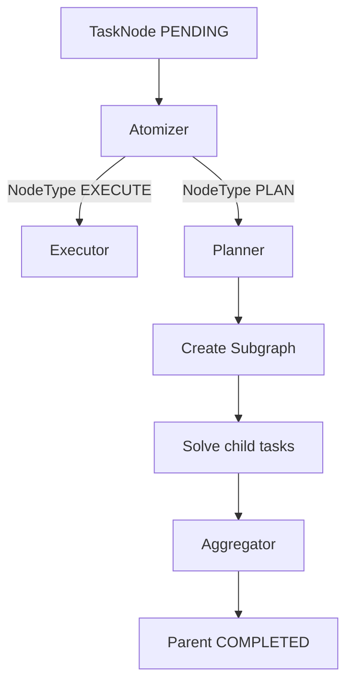

# ROMA Agent Planning and Orchestration (Implementation-Focused Guide)

This document explains the **current planning and orchestration architecture** in ROMA, based on the code in `src/roma_dspy`.

It is written for engineers researching multi-agent system (MAS) planning/orchestration frameworks and focuses on:
- Agent roles and runtime boundaries
- End-to-end orchestration flow
- Planning mechanics and data formats
- How to inspect and interact with planning in practice

For installation and deployment, see:
- `docs/QUICKSTART.md`
- `docs/CONFIGURATION.md`
- `docs/DEPLOYMENT.md`

---

## 1. Architectural Summary

ROMA uses a **hierarchical decomposition pipeline** with five agent modules:
- **Atomizer**: classify a task as `PLAN` or `EXECUTE`
- **Planner**: decompose a non-atomic task into subtasks plus dependency graph
- **Executor**: execute atomic tasks
- **Aggregator**: synthesize child results into parent result
- **Verifier**: optional validation module

Core orchestration primitives:
- `TaskNode`: immutable unit of work (state, metadata, execution history)
- `TaskDAG`: dependency graph + nested subgraphs for hierarchical plans
- `ModuleRuntime`: execution bridge between agent registry and DAG mutation
- `RecursiveSolver`: top-level orchestrator

Key source files:
- `src/roma_dspy/core/engine/solve.py`
- `src/roma_dspy/core/engine/runtime.py`
- `src/roma_dspy/core/engine/dag.py`
- `src/roma_dspy/core/modules/planner.py`
- `src/roma_dspy/core/signatures/signatures.py`
- `src/roma_dspy/core/signatures/base_models/subtask.py`
- `src/roma_dspy/types/task_status.py`

---

## 2. Orchestration Modes

ROMA currently supports two orchestration modes:

1. **Recursive state-machine mode** (`solve` / `async_solve`)
- Main pipeline used by CLI and API service (`ExecutionService` calls `solver.async_solve(...)`)
- Traverses state transitions directly and recursively solves subgraphs

2. **Event-driven mode** (`event_solve` / `async_event_solve`)
- Uses `EventLoopController` + `EventScheduler` + priority queue
- Better fit when you want scheduler-level control (priority, queue overflow handling, event checkpoints, parallel workers)

### High-level flow



---

## 3. Planning Mechanics (Technical Deep Dive)

### 3.1 Planning gate

A task enters planning only if:
- It is not forced to execute by depth limit (`task.depth < task.max_depth`)
- Atomizer sets `node_type = PLAN`
- State transitions into `TaskStatus.PLANNING`

Depth guard:
- If `task.should_force_execute()` is true, runtime bypasses planner and directly executes.

### 3.2 Planner contract

Planner signature (`PlannerSignature`) is:
- Input:
  - `goal: str`
  - `context: Optional[str]` (XML context)
- Output:
  - `subtasks: List[SubTask]`
  - `dependencies_graph: Optional[Dict[str, List[str]]]`

`SubTask` schema:
- `goal: str`
- `task_type: TaskType`
- `dependencies: List[str]`
- `result: Optional[str]`
- `context_input: Optional[str]`

### 3.3 Planner output format (expected)

Planner prompt and runtime logic assume subtask IDs are **index strings** (`"0"`, `"1"`, ...).

Example valid planner output:

```json
{
  "subtasks": [
    {
      "goal": "Collect the latest revenue and EPS from the company earnings release.",
      "task_type": "RETRIEVE",
      "dependencies": []
    },
    {
      "goal": "Summarize the guidance and key management commentary.",
      "task_type": "THINK",
      "dependencies": ["0"]
    },
    {
      "goal": "Write a short report with citations.",
      "task_type": "WRITE",
      "dependencies": ["0", "1"]
    }
  ],
  "dependencies_graph": {
    "0": [],
    "1": ["0"],
    "2": ["0", "1"]
  }
}
```

### 3.4 Dependency normalization and subgraph materialization

`ModuleRuntime._create_subtask_graph(...)` transforms planner output into runtime DAG form:

1. Create `TaskNode` for each `SubTask`
2. Build `index -> task_id` mapping
3. Convert `dependencies_graph` index references to real `task_id` references
4. Validate/ignore invalid dependency indices
5. Create nested subgraph on parent task
6. Register index mapping in `ContextStore` (used for context reconstruction)

Important behavior:
- Invalid indices are skipped
- Self-dependencies are removed
- Out-of-range dependency references are ignored
- Cross-DAG dependency references are filtered by `TaskDAG.create_subgraph(...)`

### 3.5 Planner context injection

Planner receives:
- Fundamental context (objective, time, recursion metadata)
- Planner-specific context:
  - Parent results
  - Completed sibling results
  - Optional artifact references (based on `artifact_injection_mode`)

Planner context intentionally does **not** include file-system execution paths (unlike executor).

### 3.6 Planning completion and handoff

After successful planning:
- Parent task state becomes `PLAN_DONE`
- Parent task stores `subgraph_id`
- Child tasks in subgraph become executable units
- Orchestrator moves to child execution and then aggregation when subgraph is terminal

---

## 4. Task State Machine

Primary states (see `TaskStatus`):
- `PENDING`
- `ATOMIZING`
- `PLANNING`
- `PLAN_DONE`
- `READY`
- `EXECUTING`
- `AGGREGATING`
- `COMPLETED`
- `FAILED`
- `NEEDS_REPLAN`

Typical planned-task path:

```text
PENDING -> ATOMIZING -> PLANNING -> PLAN_DONE -> AGGREGATING -> COMPLETED
```

Typical atomic-task path:

```text
PENDING -> ATOMIZING -> EXECUTING -> COMPLETED
```

Failure path includes retry and possible `FAILED` final state. Retry policy is task-type aware (`RETRIEVE`, `THINK`, etc.) and applies backoff.

---

## 5. Orchestration Pseudocode

### 5.1 Recursive mode pseudocode

```python
def async_solve(task, dag):
    task = init_task_and_attach_to_dag(task, dag)

    if task.depth >= task.max_depth:
        return force_execute(task)

    if task.status == PENDING:
        task = atomize(task)

    if task.status == ATOMIZING:
        task = transition_from_atomizing(task)  # -> PLANNING or EXECUTING

    if task.status == PLANNING:
        task = plan(task)  # creates subgraph and sets PLAN_DONE

    if task.status == EXECUTING:
        task = execute(task)
        return task

    if task.status == PLAN_DONE:
        solve_subgraph_recursively(task.subgraph)
        task = aggregate(task)
        return task

    return task
```

### 5.2 Event-driven mode pseudocode

```python
enqueue_ready_tasks_from_dag()

while not dag_complete:
    event = priority_queue.get()

    if event.type == READY:
        if task.status == PENDING:
            atomize_and_requeue(task)
        elif task.status == PLANNING:
            plan(task)
            enqueue_ready_children_or_emit_subgraph_complete(task)
        elif task.status == EXECUTING:
            execute(task)
            emit(COMPLETED)
        elif task.status == AGGREGATING:
            aggregate(task)
            emit(COMPLETED)

    elif event.type == COMPLETED:
        enqueue_new_ready_tasks()
        if parent_subgraph_is_complete:
            emit(SUBGRAPH_COMPLETE for parent)

    elif event.type == SUBGRAPH_COMPLETE:
        aggregate_parent()
        emit(COMPLETED)

    elif event.type == FAILED:
        if task_can_retry:
            schedule_retry_with_backoff()
        else:
            mark_failed_and_propagate()
```

---

## 6. Planning and DAG Data Formats

### 6.1 Runtime task representation

Each `TaskNode` tracks:
- identity (`task_id`, `parent_id`, `execution_id`)
- planning metadata (`node_type`, `task_type`, `subgraph_id`)
- state (`status`)
- dependency sets (`dependencies`, `children`)
- module histories (`execution_history`)
- metrics and retry counters
- transition history (`state_transitions`)

### 6.2 Checkpoint DAG snapshot format

Checkpoint DAG snapshots (`DAGSnapshot`) store:
- `dag_id`
- `tasks: Dict[str, TaskSnapshot]`
- `dependencies: Dict[str, List[str]]`
- nested `subgraphs`
- statistics (task counts, status distribution, etc.)

This is the primary serialized planning artifact for recovery and visualization.

### 6.3 LM trace format for planner introspection

Planner invocations are persisted with `module_name = "planner"` in LM traces, including:
- prompt/response
- token usage
- cost
- latency
- task linkage (`task_id`, `execution_id`)

---

## 7. Inspecting and Interacting with Planning

## 7.1 Inspect planner directly (module-level)

```python
from roma_dspy import Planner

planner = Planner.from_provider(model="openrouter/google/gemini-2.5-flash")
plan = planner.forward("Design a 2-week onboarding plan for backend engineers")

print(plan.subtasks)
print(plan.dependencies_graph)
```

Use this to iterate quickly on planner prompt behavior independent of full orchestration.

## 7.2 Inspect planning inside full solver execution

```python
import asyncio
from roma_dspy.core.engine.solve import RecursiveSolver
from roma_dspy.config.manager import ConfigManager

config = ConfigManager().load_config(profile="general")
solver = RecursiveSolver(config=config)

result = asyncio.run(solver.async_solve("Compare 3 cloud queueing options for throughput and cost"))
dag = solver.last_dag

print("Root status:", result.status)
print("DAG stats:", dag.get_statistics())
print("DAG export keys:", dag.export_to_dict().keys())
```

Useful DAG inspection methods:
- `dag.get_statistics()`
- `dag.export_to_dict()`
- `dag.get_all_tasks(include_subgraphs=True)`
- `dag.find_node(task_id)`

## 7.3 Inspect planner traces via API

After creating an execution:

```bash
# List planner-only LM traces
curl "http://localhost:8000/api/v1/executions/<execution_id>/lm-traces?module_name=planner&limit=200"

# Get detailed execution + DAG statistics
curl "http://localhost:8000/api/v1/executions/<execution_id>"

# Fetch latest checkpoint DAG snapshot (includes planned subgraphs)
curl "http://localhost:8000/api/v1/executions/<execution_id>/checkpoint"
```

## 7.4 Inspect planning with CLI and TUI

```bash
# Run a task
roma-dspy solve "Build a go-to-market plan for a new devtool" --profile general

# Browse/inspect execution interactively
roma-dspy viz-interactive
# or
roma-dspy viz-interactive <execution_id>
```

Checkpoint introspection:

```bash
roma-dspy checkpoint list <execution_id>
roma-dspy checkpoint get <checkpoint_id>
```

## 7.5 Planner-focused tests

```bash
# Planner unit/integration checks
pytest tests/test_modules.py -k planner

# Context integration checks related to planner context
pytest tests/integration/test_context_integration.py -k planner
```

---

## 8. How to Customize Planning Behavior

### 8.1 Override planner instructions and demos

Planner behavior is controlled by:
- signature (`PlannerSignature` or custom inline signature)
- `signature_instructions`
- `demos`

Config entry example:

```yaml
agents:
  planner:
    prediction_strategy: chain_of_thought
    signature_instructions: "prompt_optimization.seed_prompts.planner_seed:PLANNER_PROMPT"
    demos: "prompt_optimization.seed_prompts.planner_seed:PLANNER_DEMOS"
```

### 8.2 Task-aware planner variants

ROMA supports `(AgentType, TaskType)` registry mappings via `agent_mapping`.
You can register specialized planners per task type (`RETRIEVE`, `THINK`, `WRITE`, etc.) while keeping a default fallback planner.

### 8.3 Artifact visibility policy for planner

`artifact_injection_mode` controls what artifacts planner can see:
- `none`
- `dependencies`
- `subtask`
- `full`

This is useful when researching context-minimal vs context-rich planning policies.

---

## 9. Design Notes for MAS Planning/Orchestration Research

This implementation makes several explicit choices that are useful for MAS framework analysis:

- **Hierarchical DAG decomposition** instead of flat task queues
- **Immutable task nodes** with explicit state transitions and full execution history
- **Planner output normalization layer** (index graph -> stable runtime task IDs)
- **Dual orchestration models** (recursive vs event-driven)
- **Built-in recoverability** via checkpoint snapshots and recovery plans
- **Context separation by agent role** (planner/executor/aggregator get different context contracts)

Potential extension points:
- Add planner quality feedback loop (`NEEDS_REPLAN` policies)
- Add plan scoring/ranking before subgraph creation
- Add scheduler policies for depth-aware or cost-aware prioritization
- Add planner-specific evaluator/verifier coupling before execution fan-out

---

## 10. Code Map (Planning/Orchestration Hotspots)

- Planner module: `src/roma_dspy/core/modules/planner.py`
- Planner signature + format: `src/roma_dspy/core/signatures/signatures.py`
- SubTask model: `src/roma_dspy/core/signatures/base_models/subtask.py`
- Runtime planner integration: `src/roma_dspy/core/engine/runtime.py`
- DAG and subgraph logic: `src/roma_dspy/core/engine/dag.py`
- Recursive solver orchestration: `src/roma_dspy/core/engine/solve.py`
- Event-driven orchestration: `src/roma_dspy/core/engine/event_loop.py`, `src/roma_dspy/core/engine/scheduler.py`, `src/roma_dspy/core/engine/events.py`
- Context injection for planner: `src/roma_dspy/core/context/manager.py`
- Checkpoint/recovery: `src/roma_dspy/resilience/checkpoint_manager.py`
- API inspection routes: `src/roma_dspy/api/routers/executions.py`, `src/roma_dspy/api/routers/traces.py`, `src/roma_dspy/api/routers/checkpoints.py`

